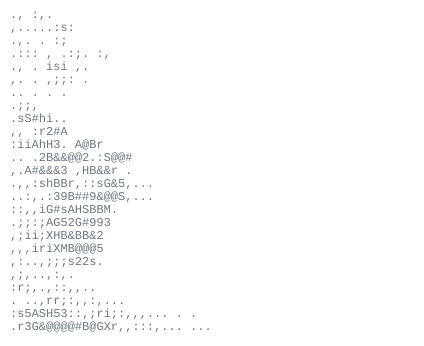

<!-- GitHub profile README -->

  

<h1 align="center">Rémi Menguy</h1>

  Founder of <a href="https://www.looba.dev">Looba</a> · Currently building <strong>Kroco</strong>

  <a href="https://remimenguy.site">Website</a> ·
  <a href="https://instagram.com/remi_mny">Instagram</a>

## 01 — About

Hello, I’m Rémi Menguy. I enjoy coding and building projects that make everyday life easier, both for myself and for others.

## 02 — Stack

**Languages** — TypeScript · JavaScript · Python · Swift · Java · Bash 
**Frontend** — React · Alpine.js · HTML · CSS · WordPress 
**Backend & data** — Node.js · PostgreSQL 
**Cloud & infrastructure** — Cloudflare · Azure · Google Cloud · Nginx · Apache 
**Design & creative** — Figma · Photoshop · After Effects · Premiere Pro · Lightroom 
**Workflow** — Git · Vitest · Notion

## 03 — GitHub activity

  
  

